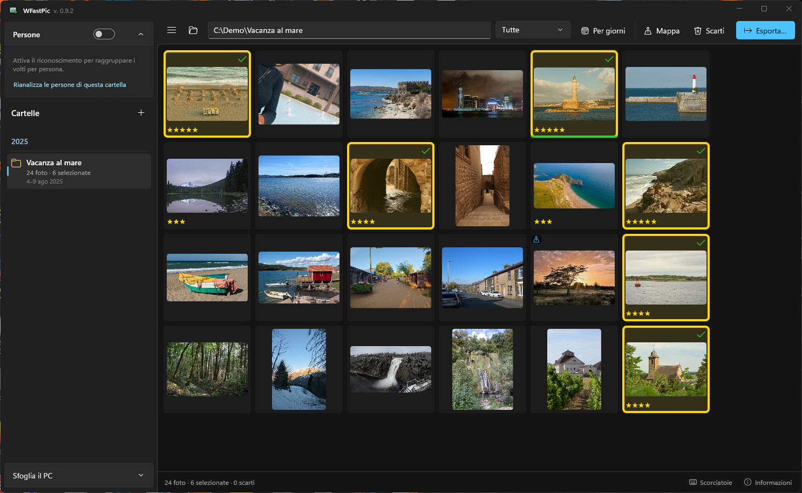
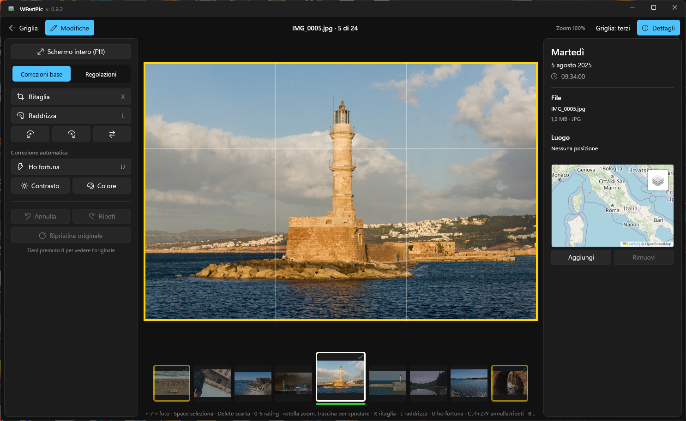

<p align="center">
  
</p>

# WFastPic

<p align="center">
  <a href="https://github.com/Walt7/WFastPic/releases/latest"></a>
  <a href="https://github.com/Walt7/WFastPic/releases"></a>
  <a href="LICENSE"></a>
  
  
  
  
  <a href="https://github.com/Walt7/WFastPic/commits/master"></a>
  <a href="https://github.com/Walt7/WFastPic/stargazers"></a>
</p>

**Un tributo open source a Picasa, per Windows: scegliere e sistemare in fretta centinaia di foto.**
Versione attuale: **1.0.0** · [Scarica](https://github.com/Walt7/WFastPic/releases/latest) ·
[novità](CHANGELOG.md) · [English version](README.en.md) · [English below](#english)

Google ha smesso di sviluppare Picasa nel 2016 e non legge le foto HEIC dei telefoni di oggi. WFastPic è un omaggio al suo modo di lavorare — cartelle per anno, la barra spaziatrice
per tenere le foto buone, ritocchi con un clic, persone, mappa, export — ed è pensato per le grandi
raccolte di foto HEIC (iPhone, droni, fotocamere): apri la cartella della vacanza, tieni le migliori,
scarti le altre, dai una sistemata veloce ed esporti. Tutto da tastiera, senza mai aspettare.

Non è un Lightroom e non è un gestore di file: è lo strumento per passare da 1300 scatti alle 80
foto da tenere, nel minor numero di gesti possibile.

<p align="center">
  
</p>
<p align="center">
  
</p>
<p align="center"><sub>Foto di esempio con licenza CC0 da Wikimedia Commons (<a href="assets/crediti-foto-screenshot.md">crediti</a>).</sub></p>

## Perché esiste

Di Picasa mi mancava una cosa sopra tutte: poter passare in rassegna tutte le foto di una vacanza,
scegliere al volo quelle buone, sistemarle con un clic e poi estrarle. Nessun altro programma lo fa in
modo così comodo e veloce. WFastPic è il mio modo di riavere quel programma: la stessa comodità —
selezionare, migliorare al volo, esportare — sul Windows di oggi e con le foto HEIC dei telefoni.

*— Walter*

## Da Picasa a WFastPic

| In Picasa | In WFastPic |
|---|---|
| Cartelle raggruppate per anno | Pannello cartelle per anno, con numero di foto e periodo |
| Stelle e foto "tenute" | `Space` seleziona, `0`–`5` stelle, `Canc` scarta (mai cancellazione irreversibile) |
| "Ho fortuna" | `U`: contrasto e colore automatici in un colpo |
| Ritaglia e raddrizza | Ritaglio con proporzioni e ritagli suggeriti, raddrizzamento insieme al ritaglio |
| Persone (volti con nome) | Riconoscimento dei volti sul tuo PC, nomi validi in tutte le cartelle, "È la stessa persona di…" |
| Foto sulla mappa | Mappa delle foto e nomi dei luoghi |
| Esporta | JPEG ridimensionati, filigrana, tag, data e GPS conservati |
| — | Raffiche riconosciute da sole, foto HEIC, Live Photo, dati dei droni DJI |

**Cosa non c'è (per scelta o non ancora):** collage e proiezioni, album web, riproduzione dei video,
fotoritocco avanzato (esposizione a curve, maschere). WFastPic non carica le tue foto da nessuna parte.

## Cosa fa

**Scegliere**
- Griglia veloce anche con migliaia di foto, in ordine di scatto, divisibile per giorno.
- `Space` seleziona, `Canc` scarta, `0`–`5` stelle, `Tab` cambia filtro.
- **Raffiche** riconosciute da sole (foto scattate a pochi secondi): `Shift+Space` tiene questa e
  scarta le altre del gruppo. Nell'editor le foto della stessa raffica compaiono in piccolo accanto
  alla foto, per confrontarle al volo.
- Scarti mai cancellati per sbaglio: vanno nel Cestino di Windows (con conferma) o nella cartella
  `Scarti/`, sempre insieme al video abbinato (Live Photo).

**Sistemare** (sempre senza toccare l'originale)
- Ritaglia con proporzioni e ritagli suggeriti che non tagliano i volti; raddrizza; gira di 90° e
  specchia.
- "Ho fortuna", contrasto e colore automatici, luce di riempimento, alte luci, ombre, temperatura.
- Annulla / ripeti, `B` per vedere l'originale, schermo intero con `F11`.
- Colonna dei dettagli: giorno della settimana, data e ora di scatto, file, luogo con mini-mappa,
  dispositivo e dati di ripresa (anche altezza e gimbal dei droni DJI).

**Ritrovare**
- Cartelle raggruppate per anno, come in Picasa.
- Mappa delle foto, nomi dei luoghi, posizione correggibile a mano.
- Persone (opzionale): volti simili raggruppati, ai quali dai un nome che vale in tutte le cartelle.

**Esportare**
- JPEG alle dimensioni originali o ridimensionati, qualità a scelta, filigrana, tag.
- Data di scatto e posizione GPS conservate (o rimosse, se preferisci).

## Installare

Dalla [pagina delle release](https://github.com/Walt7/WFastPic/releases/latest):
- **`WFastPic-<versione>-win-x64-setup.exe`** (consigliato): doppio clic e avanti. Non servono permessi
  di amministratore, crea il collegamento nel menu Start e si disinstalla da "App installate" di Windows
  (foto, sidecar e impostazioni restano). Per aggiornare basta installare la versione nuova sopra.
- **`WFastPic-<versione>-win-x64.zip`**: versione portatile, si scompatta dove vuoi e si avvia
  `WFastPic.App.exe`.

Il programma non è firmato digitalmente: al primo avvio Windows può mostrare "Windows ha protetto il PC";
si prosegue con "Ulteriori informazioni" → "Esegui comunque".

## Requisiti

- Windows 10 (1809 o successivo) o Windows 11, x64 o ARM64.
- Per le foto HEIC servono le estensioni **HEIF** e **HEVC** di Windows: di solito ci sono già; se le
  foto non si aprono, si installano dal Microsoft Store.

## Compilare e avviare

Serve l'SDK di [.NET 10](https://dotnet.microsoft.com/download). Visual Studio non è obbligatorio.

```bash
dotnet build WFastPic.slnx
```

L'app si trova poi in `src/WFastPic.App/bin/x64/Debug/net10.0-windows10.0.22621.0/win-x64/WFastPic.App.exe`.

Test:

```bash
dotnet test tests/WFastPic.Core.Tests
```

## Scorciatoie principali

| Dove | Tasti |
|---|---|
| Griglia e editor | `←` / `→` foto precedente / successiva · `Space` seleziona · `Canc` scarta · `0`–`5` stelle |
| Griglia | `Shift+Space` tieni e scarta il resto della raffica · `Tab` filtro · `Ctrl+A` seleziona le visibili · `Shift+rotella` dimensione miniature · `Invio` apri |
| Editor | `X` ritaglia · `L` raddrizza · `R` / `Shift+R` gira · `U` Ho fortuna · `B` originale · `Ctrl+Z` / `Ctrl+Y` · `F11` schermo intero · `Esc` chiudi |

L'elenco completo è nell'app, sotto "Scorciatoie" nella barra in basso.

## Le tue foto restano tue

- Le foto originali non vengono mai modificate: selezioni, stelle e modifiche stanno in una cartella
  nascosta `.wfastpic` accanto alle foto.
- Tutto gira sul PC. Escono solo le richieste che puoi spegnere o che scegli tu:
  - i nomi dei luoghi chiesti a OpenStreetMap (disattivabile dalla mappa) e i riquadri delle mappe;
  - i modelli per il riconoscimento delle persone, scaricati una volta sola da Hugging Face (OpenCV)
    solo se attivi l'opzione;
  - il controllo della versione nuova su GitHub all'avvio (disattivabile dalle Informazioni) e, solo se
    la invii tu, la segnalazione di un errore. Le foto non escono mai.
- Nessun account, nessuna statistica d'uso, nessuna telemetria. Il dettaglio di cosa esce, verso chi e
  come spegnerlo è nella [nota sulla privacy](PRIVACY.md).

## Per chi sviluppa

- Architettura, convenzioni e stato del progetto: [`AGENTS.md`](AGENTS.md).
- Novità di ogni versione: [`CHANGELOG.md`](CHANGELOG.md).
- C# + WinUI 3 (Windows App SDK), decodifica HEIC con WIC, sidecar SQLite per cartella. La logica sta
  nei progetti `WFastPic.Core.*`, senza dipendenze da WinUI, ed è coperta da test xUnit.

## Licenza

[MIT](LICENSE): puoi usarlo, modificarlo e ridistribuirlo liberamente, mantenendo l'avviso di copyright.

Non è affiliato a Google: Picasa è un marchio di Google LLC, citato solo per dire a cosa si ispira questo
progetto.

---

## English

**WFastPic is an open source tribute to Google Picasa, for Windows** — a fast photo viewer,
organizer and quick editor for large photo collections, especially **HEIC** photos from iPhones,
drones and cameras. If you are looking for a **Picasa alternative** that runs on Windows 10/11, this is it.

Open a vacation folder, press `Space` to keep the good shots, `Delete` to reject the rest, fix a few
photos in one click and export. Everything is keyboard-driven and never makes you wait.

- **Culling:** fast grid with thousands of photos, star ratings, burst detection ("keep this one,
  reject the rest of the burst"), rejects go to the Recycle Bin or a `Scarti/` folder — never deleted
  for good by mistake.
- **Quick fixes (non-destructive):** crop with suggested crops that avoid cutting faces, straighten,
  rotate/flip, *I'm Feeling Lucky* auto contrast and color, fill light, highlights, shadows, temperature.
  Originals are never modified.
- **Finding photos:** folders grouped by year like Picasa, photo map with place names, optional
  on-device face recognition with names shared across folders.
- **Export:** JPEG at original or reduced size, watermark, tags, EXIF date and GPS preserved (or removed).
- **Private:** everything runs on your PC; your photos never leave it ([privacy note](PRIVACY.en.md)).

**Download:** [latest release](https://github.com/Walt7/WFastPic/releases/latest) — run the setup
(`…-win-x64-setup.exe`, no admin rights needed) or unzip the portable `.zip` and run `WFastPic.App.exe`
(Windows 10 1809+ or Windows 11, x64). HEIC photos need the HEIF and HEVC extensions
from the Microsoft Store if Windows does not already have them. The interface is in Italian and English.

Built with C# and WinUI 3 (Windows App SDK). MIT licensed. Not affiliated with Google: Picasa is a trademark of Google LLC, mentioned only to say
what inspired this project.
